# GT7 & PC SimHub Switch Sim-DDU Pro (Nintendo Switch Sim Racing & EV Cockpit DDU)
**Version / 版本號: `_aw_1.11.06.1205` (PS5 GT7 + PC SimHub / Forza Horizon 6 Dual-Engine & True OLED Black Edition)**

  <b>🌐 Language Navigation / 語言切換 / 言語切替 / Sprachauswahl:</b>  
  <a href="#-繁體中文-traditional-chinese">🇹🇼 繁體中文</a> &nbsp;|&nbsp;
  <a href="#-english">🇬🇧 English</a> &nbsp;|&nbsp;
  <a href="#-日本語-japanese">🇯🇵 日本語</a> &nbsp;|&nbsp;
  <a href="#-deutsch-german">🇩🇪 Deutsch</a>

  <i>Dedicated Full Documentation Files:</i> 
  <a href="README_ZH.md"><b>[繁體中文完整文件]</b></a> &nbsp;•&nbsp;
  <a href="README_EN.md"><b>[English Full Docs]</b></a> &nbsp;•&nbsp;
  <a href="README_JA.md"><b>[日本語フルドキュメント]</b></a> &nbsp;•&nbsp;
  <a href="README_DE.md"><b>[Deutsche Dokumentation]</b></a>

  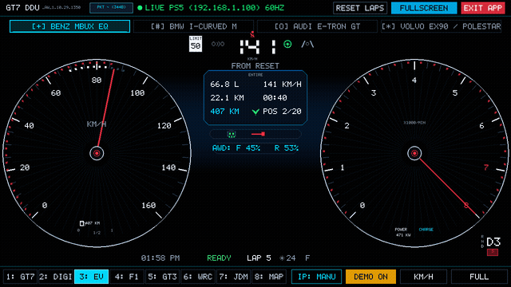

---

## 🖤 True OLED Pitch Black (`#000000`) & 11 Full-Screen Telemetry Views

| Mode 1: Official GT7 Native HUD & MFD | Mode 2: High-Res Digital Tachometer DDU |
| :---: | :---: |
| 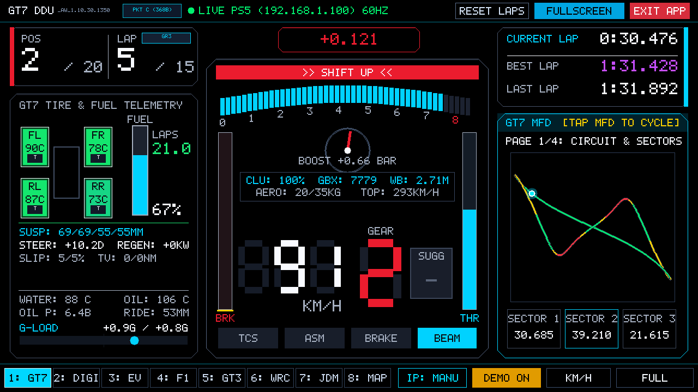 | 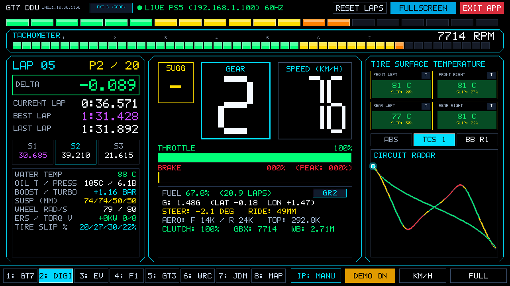 |
| **Mode 3A: Mercedes-Benz MBUX Hyperscreen EQ** | **Mode 3B-1: BMW iDrive 9 `///M SPORT` Cockpit** |
| 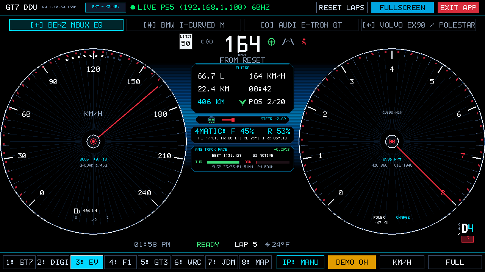 | 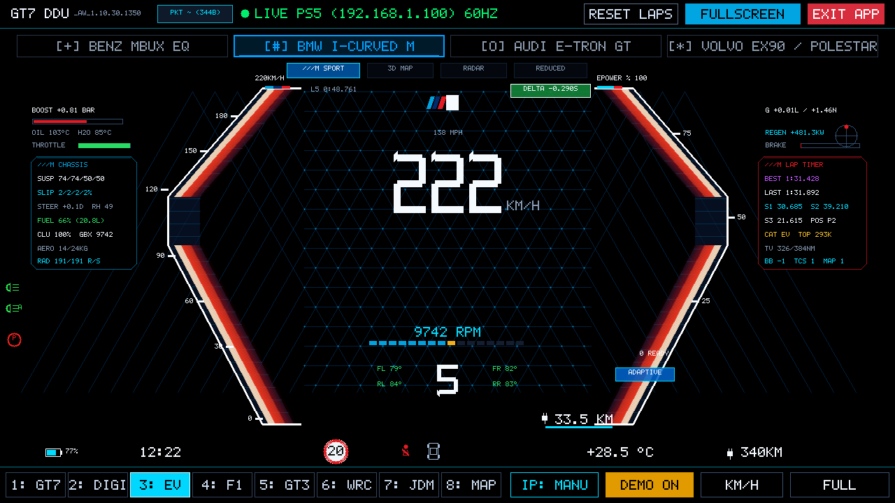 |
| **Mode 3B-2: BMW iDrive 9 `3D MAP` Navigation** | **Mode 3B-3: BMW iDrive 9 `RADAR` Assisted View** |
| 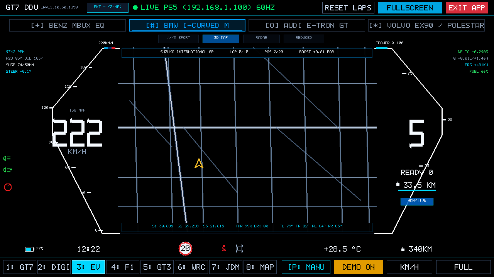 | 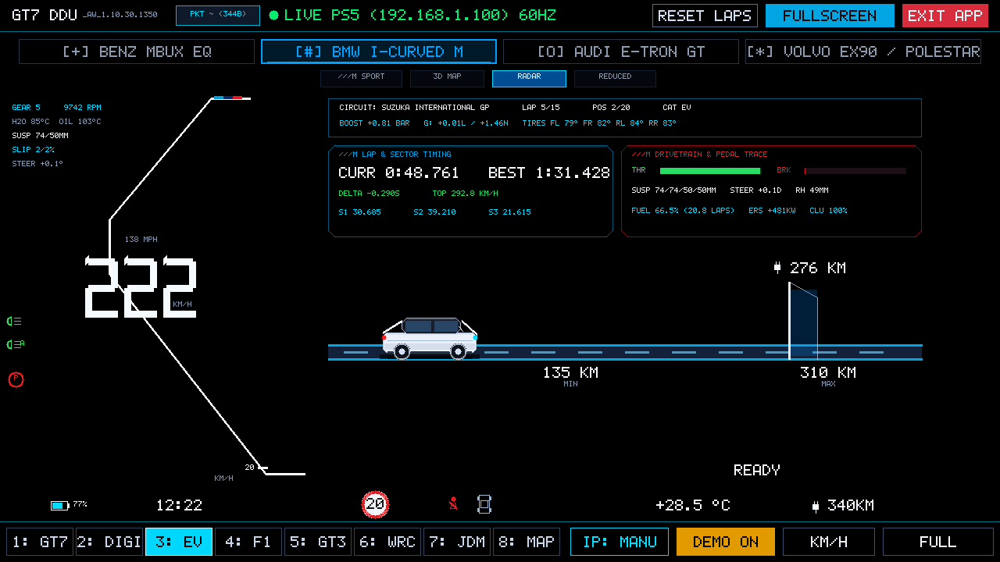 |
| **Mode 3B-4: BMW iDrive 9 `REDUCED` Panoramic Map** | **Mode 3C: Audi Virtual Cockpit Plus RS e-tron GT** |
| 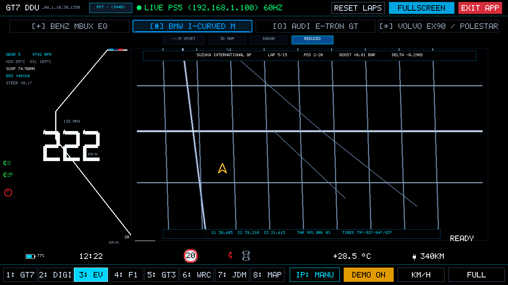 | 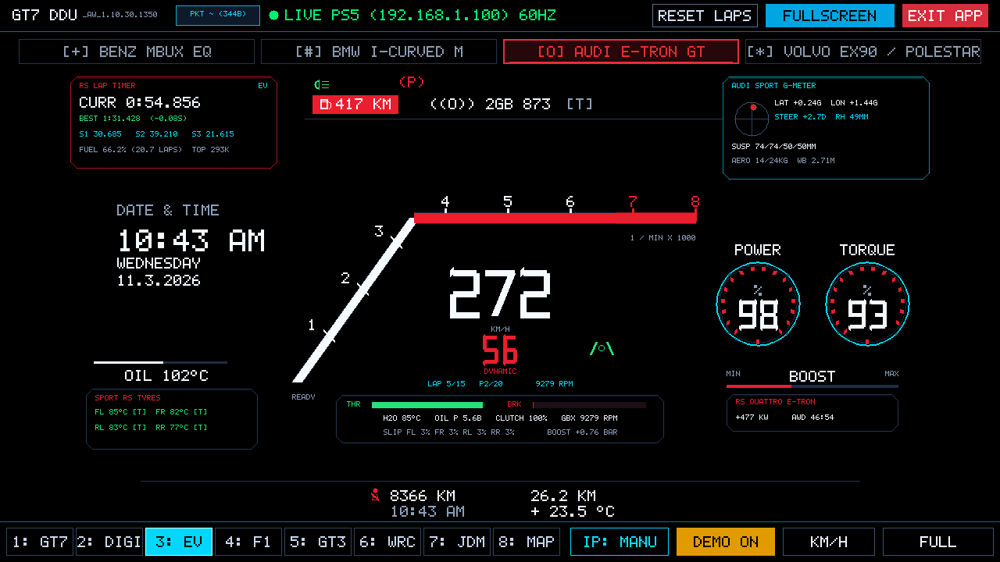 |
| **Mode 3D: Volvo EX90 / Polestar Minimalist** | **Mode 4: F1 Grand Prix Steering Wheel (PCU-8D)** |
| 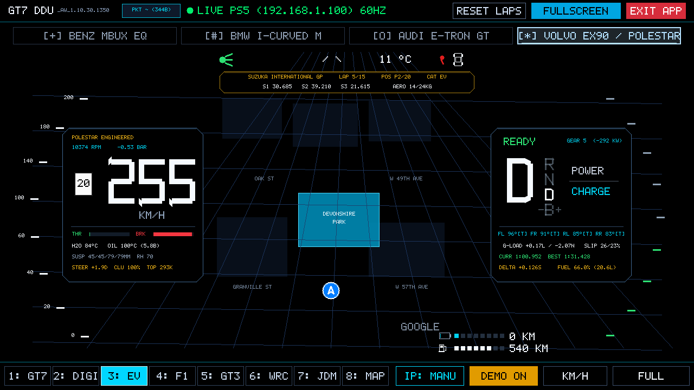 | 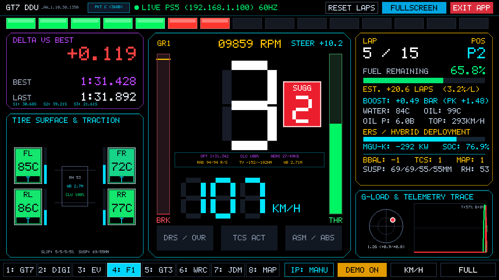 |
| **Mode 5: GT3 Endurance MoTeC C1212 DDU** | **Mode 6: WRC Rally Stage Cockpit** |
| 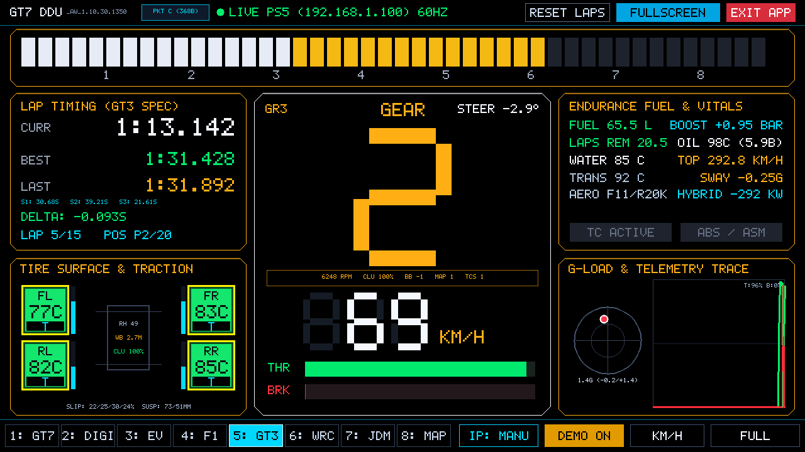 | 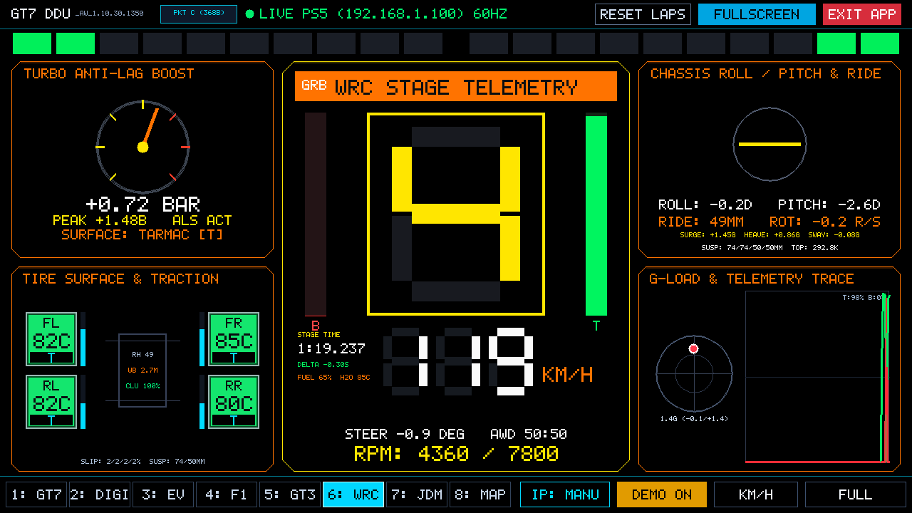 |
| **Mode 7: JDM Defi Advance ZD Multi-Meter** | **Mode 8: GPS Track Radar & Pit Strategy** |
| 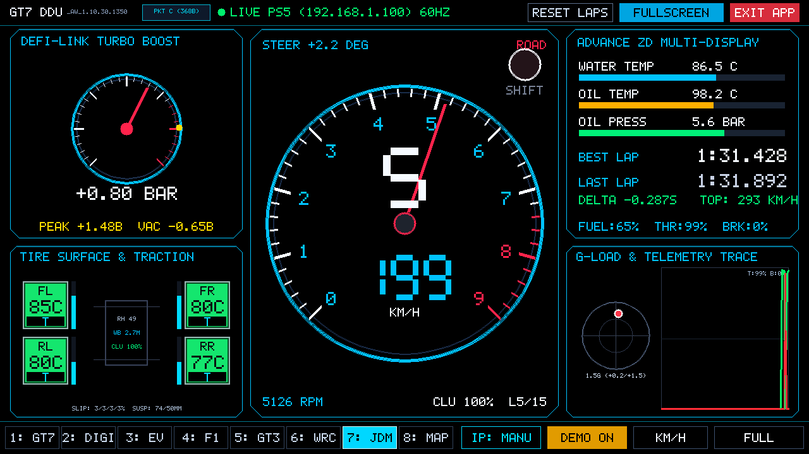 | 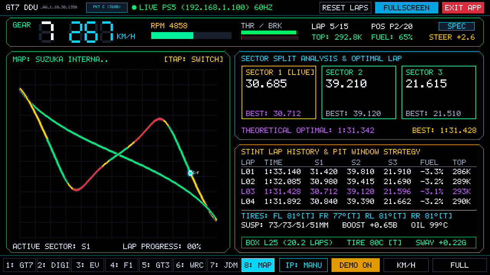 |

---

## 🏎️ GT7 Telemetry Protocol Architecture & Comparison / 跑車浪漫旅 7 遙測封包規格比較

| Telemetry Channel / 遙測頻道 | Packet A (傳統封包) | Packet B (慣性頻道) | Packet ~ (純電進階封包) | Packet C (完整賽事旗艦封包) |
| :--- | :---: | :---: | :---: | :---: |
| **封包長度 (Byte Length)** | **296 Bytes** (`0x128`) | **316 Bytes** (`0x13C`) | **344 Bytes** (`0x158`) | **368 Bytes** (`0x170`) |
| **心跳字元 (Heartbeat Char)** | `'A'` / `'a'` | `'B'` / `'b'` | `'~'` | `'C'` / `'c'` |
| **基礎車況 (Speed, RPM, Gear, Fuel, Temps)** | ✅ `0x00`–`0x127` | ✅ `0x00`–`0x127` | ✅ `0x00`–`0x127` | ✅ `0x00`–`0x127` |
| **6-DoF 慣性物理 (Surge/Sway/Heave G, Yaw Rate)** | ❌ (差分計算) | ✅ `0x128`–`0x13B` | ✅ `0x128`–`0x13B` | ✅ `0x128`–`0x13B` |
| **4輪扭力向量分配 (4-Wheel Torque Vectors Nm)** | ❌ | ❌ | ✅ `0x140`–`0x14F` | ❌ |
| **即時回充發電與輸出功率 (Regen & Drive Power kW)** | ❌ | ❌ | ✅ `0x150`–`0x153` | ❌ |
| **高壓電池電量 (Battery State of Charge %)** | ❌ | ❌ | ✅ `0x154`–`0x157` | ❌ |
| **4輪接地路面類型 (Surface Patch: Tarmac/Curb/Dirt)** | ❌ | ❌ | ❌ | ✅ `0x13C`–`0x13F` (`T`/`C`/`D`/`G`/`S`) |
| **GT7 毫秒單圈計時器 (Millisecond Exact Lap Timer)** | ❌ (主機估算) | ❌ (主機估算) | ❌ (主機估算) | ✅ `0x140`–`0x143` (GT7 內部引擎精確 ms) |
| **前雙輪精準轉向角 (Front Wheel Steering Angles)** | ❌ | ❌ | ❌ | ✅ `0x144`–`0x14B` (FL / FR 輪胎徑度轉向) |
| **軸距長度 (Vehicle Wheelbase)** | ❌ | ❌ | ❌ | ✅ `0x14C`–`0x14F` (米) |
| **GT7 官方車輛組別代碼 (Car Category)** | ❌ | ❌ | ❌ | ✅ `0x150`–`0x157` (`"Gr.1"`, `"Gr.3"`, `"Gr.B"`) |
| **前/後空氣動力下壓力 (Front/Rear Aero Downforce)** | ❌ | ❌ | ❌ | ✅ `0x15C`–`0x163` (kg/N) |
| **變速箱機油油溫 (Transmission Oil Temp)** | ❌ | ❌ | ❌ | ✅ `0x164`–`0x167` (°C) |
| **本系統連線模式支援 (Sim-DDU Mode)** | 相容舊版本 | 慣性物理平滑 | **EV 豪華純電座艙** (自動智能選用) | **賽事模式/DDU/雷達** (自動智能選用) |

---

## 🇹🇼 繁體中文 (Traditional Chinese)

專為 **Nintendo Switch (V1 / V2 / Switch OLED 大氣層 Atmosphère 破解系統)** 打造的原生 Homebrew 賽車儀表板 App (`.nro`)。透過 Wi-Fi 接收 **PS5 / PS5 Pro《Gran Turismo 7 (跑車浪漫旅 7)》** 60Hz UDP 遙測封包，將 Switch 拆下左右 Joy-Con 搖桿後，直接架設於賽車方向盤基座前方，化身為高精準度、低延遲的頂級 **Sim Racing DDU (Dashboard Display Unit)**。

### 內建 8 大賽車與純電儀表板模式（共 11 種專屬全螢幕視圖）
1. **Mode 1: Official GT7 Native HUD & MFD (`1: GT7`)**：忠實還原 Polyphony Digital 原廠弧形轉速條、紅區閃爍提示、車速/檔位/建議檔位、四輪避震行程/滑移率/扭力向量，並整合 4 頁切換式 MFD。
2. **Mode 2: High-Res Digital Tachometer DDU (`2: DIGI`)**：頂部 20 顆超轉 LED 與 50 階高解析漸變轉速條、油門煞車踩踏峰值記憶（PEAK BRAKE）、四輪避震與角速度 (rad/s)、下壓力與離合器狀態。
3. **Mode 3: Luxury EV Digital Cockpit (`3: EV`)**：四大頂級純電品牌儀表：
   - **Mercedes-Benz MBUX Hyperscreen EQ**：雙圓放射星芒錶盤、4MATIC 四驅扭力分配、四輪胎溫與接觸面 `[T/C/D]`、**AMG TRACK PACE** 單圈差時與避震監控。
   - **BMW i-Curved Display (iDrive OS 8.5 / 9 專屬四視圖套件)**：支援觸控與 `B` / `V` 鍵切換 4 種真實 BMW 原廠視圖：
     - **`///M SPORT`**：雙側對稱外推六角形框、紅藍漸層能量光翼、中央 3D 菱格網、左右 `///M CHASSIS` 與 `///M LAP TIMER` 完整遙測卡。
     - **`3D MAP`**：左右六角形框內嵌堆疊時速與檔位，中央全幅 3D 夜間城市導航與賽道分段看板。
     - **`RADAR`**：左側單斜角速度框、3D 透視車道與 BMW 車模、車距雷達光牆與上方雙區 `///M` 賽道計時／踏板遙測卡。
     - **`REDUCED`**：極簡單斜角速度框搭配右側超寬幅全景 3D 導航地圖。
   - **Audi Virtual Cockpit Plus RS e-tron GT**：經典曲棍球桿轉速錶、雙環 Power/Torque、左上 **RS LAP TIMER** 與右上 **AUDI SPORT G-METER**。
   - **Volvo EX90 / Polestar Minimalist**：北歐極簡雙資訊艙、**Polestar Engineered** 動力底盤數據、頂部黃金賽道分段膠囊與中央 3D 導航。
4. **Mode 4: F1 Grand Prix Steering Wheel (`4: F1`)**：模擬 Mercedes W14 / Ferrari SF23 PCU-8D 方向盤儀表，內建理論最佳單圈 (Optimal Lap)、ERS MGU-K 能量部署、空力下壓力與四輪滑移率。
5. **Mode 5: GT3 Endurance MoTeC DDU (`5: GT3`)**：耐力賽標準 MoTeC C1212 寬幅掃描轉速錶、煞車偏置/TCS/燃油映射條、燃油圈數計算與雙欄耐力賽監控。
6. **Mode 6: WRC Rally Stage Cockpit (`6: WRC`)**：拉力賽防滾籠專用 HUD，整合車身傾角儀（Roll / Pitch Horizon）、三軸 Surge/Heave/Sway G 值與四輪路面材質識別。
7. **Mode 7: JDM Defi Advance ZD Multi-Meter (`7: JDM`)**：日系改裝經典指針式渦輪增壓錶（含 Peak 記憶針）與 9000 RPM 大錶，搭配 Advance ZD OLED 液晶條。
8. **Mode 8: GPS Track Map & Race Engineer (`8: MAP`)**：大尺寸 2D GPS 賽道圖、煞車/加速熱力行車線、S1/S2/S3 分段與理論最佳單圈、進站窗口策略與四輪胎溫/避震矩陣。

### 100% 零搖桿全觸控與 True OLED `#000000` 極致純黑校準
- **True OLED Pitch Black (`#000000`)**：所有模式背景、儀表卡片、地圖畫布與軌跡圖全面採用絕對純黑 `rgba(0,0,0,255)`，讓 Switch OLED 黑色像素完全關閉不發光，呈現無限對比度與零光暈視覺體驗。
- **一鍵全螢幕 (`FULL`)**：導覽列自動收起，畫面 100% 滿版無黑邊；輕觸左下角即刻跳出全螢幕。
- **自動偵測 PS5 GT7 與 PC SimHub 雙遙測引擎 (`IP: AUTO`)**：
  - **PS5 / PS5 Pro《Gran Turismo 7》**：開機自動透過 UDP Port `33739` / `33740` 發送心跳封包並解密 `Packet C (368B)` / `Packet ~ (344B)` / `Packet B (316B)` / `Packet A (296B)`。
  - **PC SimHub 跨平台賽車遊戲與《Forza Horizon 5 / 6》支援 (Assetto Corsa / ACC / iRacing / F1 / Forza Horizon 4/5/6 / Forza Motorsport / rFactor 2 / Dirt Rally 2.0 / EA WRC / BeamNG.drive)**：同時監聽 UDP Port **`20777`**、**`8000`** 與 **`33740`**，自動辨識並解析 5 種 PC SimHub / Forza 遙測格式，並將所有數據完整映射至 11 種儀表視圖（含四輪扭力向量、ePower/動能回收功率、空力下壓力、單圈三區段與理論最佳圈速）：
    1. **SimHub Custom UDP JSON / 巢狀 Web API JSON (`SIMHUB JSON`)**（支援單層與巢狀 `{"newData":{...}}` / `{"NewData":{...}}` 及 `DataCorePlugin.GameData.*` 與 Forza `RawData.*` 完整屬性名）
    2. **SimHub / Forza Horizon 5 & 6 "Data Out" 二進位封包 (`SIMHUB FZA`)** (`232` Sled / `311` FM7 Dash / `324` FH4/FH5/FH6 Horizon Dash / `331` FM8 Dash)：
       - 完美對齊 Forza Horizon 12-Byte Horizon Placeholder 偏移 (`dash_off = 244`)
       - 精準匹配 Forza 檔位編碼 (`0 = R 倒檔`, `1..10 = 1..10 檔`, `11 = N 空檔`)
       - 全溫域華氏轉攝氏 (`°F -> °C`) 輪胎溫度轉換、四輪綜合滑移率 (`TireSlipRatio` + `TireCombinedSlip`)、正規化避震行程 (`0x44 NormalizedSuspensionTravel`)、路緣石/砂石路面識別 (`[T/C/D]`) 與車輛等級 (`D/C/B/A/S1/S2/X`)
    3. **SimHub / Codemasters Mode 1 二進位封包 (`SIMHUB CM1`)** (`264` Bytes，自動偵測 `RPM/10` 與直接 `RPM` 倍率)
    4. **SimHub / OutGauge 二進位封包 (`SIMHUB OTG`)** (`92` / `96` Bytes，支援 BeamNG / LFS / Assetto Corsa OutGauge)
    5. **Forza Horizon 5 / 6 + SimHub 最佳建議設定**：
       - **方法 1（SimHub UDP 轉發 — 最推薦）**：在遊戲內讓 SimHub 自動設定遙測（預設 `127.0.0.1`），接著在 SimHub 左側進入 **`Game Config / Settings` -> `UDP Forwarding`**，勾選啟用轉發，目標 IP 填寫 **Switch 的 IP**，目標 Port 填寫 **`20777`**（或 **`8000`** / **`33740`**），即可同時讓 PC SimHub 與 Switch DDU 同步接收 60Hz 完整遙測！
       - **方法 2（遊戲內直接輸出至 Switch）**：在《Forza Horizon 5 / 6》進入 **`設定 (Settings)` -> `HUD 與遊戲性 (HUD and Gameplay)`**，將 **`資料輸出 (Data Out)` 設為 `開啟 (ON)`**、**`資料輸出 IP 位址` 設為 `Switch 的 IP`**、**`資料輸出通訊埠 (Port)` 設為 `8000` 或 `20777`**。
       - **方法 3（Python 橋接器）**：執行 `python3 tools/simhub_bridge.py --switch-ip <Switch_IP> --port 20777`（或 `--listen-udp 8000 --switch-ip <Switch_IP>`）。
- 👉 **[點此閱讀繁體中文完整說明文件](README_ZH.md)**

---

## 🇬🇧 English

A native Homebrew Sim Racing Dashboard Display Unit (`.nro`) tailored specifically for **Nintendo Switch (V1, V2, and Switch OLED on Atmosphère Custom Firmware)**. Designed to receive real-time 60Hz UDP telemetry packets streamed directly from **PS5 / PS5 Pro running *Gran Turismo 7*** over local Wi-Fi. Detach the left and right Joy-Cons, mount your Nintendo Switch directly onto your wheel base, and enjoy a professional, ultra-low-latency **Sim Racing DDU**.

### 8 Motorsport & Luxury EV Cockpit Modes
1. **Mode 1: Official GT7 Native HUD & MFD (`1: GT7`)**: Curved horizon tachometer bar (46-step gradient), shift redline warning flashes, suggested gear indicators, and a 4-page interactive MFD.
2. **Mode 2: High-Res Digital Tachometer DDU (`2: DIGI`)**: 32-step graduated top shift light strip, numeric RPM counter, dual throttle/brake meters with peak brake force memory, and live delta time.
3. **Mode 3: Luxury EV Cockpits (`3: EV`)**: Four modern luxury EV clusters (**Mercedes-Benz MBUX Hyperscreen EQ**, **BMW i-Curved Display iDrive 9 M-EV**, **Audi Virtual Cockpit Plus RS e-tron GT**, **Volvo EX90 Scandinavian Minimalist**).
4. **Mode 4: F1 Steering Wheel (`4: F1`)**: Modeled after contemporary F1 PCU-8D steering wheel screens (Mercedes W14 / Ferrari SF23).
5. **Mode 5: GT3 MoTeC (`5: GT3`)**: MoTeC C1212 endurance dashboard with horizontal rev sweep and fuel lap calculator.
6. **Mode 6: WRC Rally (`6: WRC`)**: Stage rally cockpit HUD featuring chassis roll and pitch artificial horizon meters.
7. **Mode 7: JDM Defi (`7: JDM`)**: Classic JDM street-tuned analog turbo boost gauge and oversized tachometer with Advance ZD multi-display strip.
8. **Mode 8: GPS Track Map (`8: MAP`)**: Full-screen 2D GPS circuit layout, braking/throttle line heatmaps, optimal sector tracking, and pit window strategy.

### 100% Joy-Con Free Multi-Touch & Pure OLED Black
- **Edge-to-Edge Fullscreen (`FULL`)**: Menus tuck away completely for 100% screen utilization on Switch 720p display without black bars. Tap bottom-left corner to exit fullscreen.
- **Auto-Discovery (`IP: AUTO`)**: Automatically discovers PS5 / PS5 Pro via UDP broadcast without manual typing.
- **Pure OLED Black Calibration**: Non-active pixel backgrounds are set to absolute `#000000` for infinite contrast on Switch OLED screens.
- 👉 **[Read Full English Documentation](README_EN.md)**

---

## 🇯🇵 日本語 (Japanese)

**Nintendo Switch (初期型・バッテリー強化版・Switch OLED / Atmosphère 大気層 CFW 環境)** 向けに開発された、ネイティブ Homebrew レーシング＆EV デジタルメーターアプリ（`.nro`）です。Wi-Fi 経由で **PS5 / PS5 Pro の『グランツーリスモ7』(GT7)** からブロードキャストされる 60Hz UDP テレメトリーデータを受信します。Switch 本体の左右 Joy-Con を取り外し、ステアリングコントローラーの直前に設置することで、超低遅延・高精度な本格派 **Sim Racing DDU (Dashboard Display Unit)** として活用できます。

### 8 つの本格モータースポーツ＆高級 EV デジタルメーターモード
1. **Mode 1: GT7 公式純正 HUD & MFD (`1: GT7`)**: ポリフォニー・デジタル純正の美しい曲線ホライゾン・レブバー、シフト警告点滅、推奨ギア表示、4 ページ切替 MFD を完全再現。
2. **Mode 2: 高解像度デジタルタコメーター DDU (`2: DIGI`)**: 上部 32 段階シフトランプ、数値 RPM、最大ブレーキ踏力メモリー付きペダルゲージ、個別タイヤ温度、デルタタイム表示。
3. **Mode 3: 高級 EV デジタルコックピット (`3: EV`)**: 最新高級 EV 4 大ブランド（**Mercedes-Benz MBUX ハイパースクリーン EQ**、**BMW i-Curved ディスプレイ iDrive 9 M-EV**、**Audi バーチャル コックピット プラス RS e-tron GT**、**Volvo EX90 スカンジナビア・ミニマリズム**）。
4. **Mode 4: F1 ステアリング (`4: F1`)**: 現代 F1 マシン（Mercedes W14 / Ferrari SF23 PCU-8D）を模したステアリング液晶画面。
5. **Mode 5: GT3 MoTeC (`5: GT3`)**: 耐久レーシングカー用 MoTeC C1212 スイープタコメーター＆燃料残量ラップ計算。
6. **Mode 6: WRC ラリー (`6: WRC`)**: ラリー HUD、ロール＆ピッチ角を計測する車体傾斜儀を搭載。
7. **Mode 7: JDM Defi (`7: JDM`)**: アナログ針式ブースト計＆タコメーター、Advance ZD 有機 EL 風マルチメーター。
8. **Mode 8: GPS サーキットマップ (`8: MAP`)**: 2D GPS サーキットコース図、加減速ヒートマップ、最適セクタータイム比較、ピット戦略計算。

### 完全ジョイコン不要・マルチタッチ＆ピュア OLED ブラック
- **全画面フルスクリーン (`FULL`)**: 上下のバーが瞬時に格納され、Switch の 720p 画面を余白なく 100% フル活用。
- **自動探索 (`IP: AUTO`)**: 起動時に UDP ブロードキャストで PS5 / PS5 Pro を自動検知。
- **ピュア OLED ブラック校準**: 背景はすべて `#000000` に設定され、Switch OLED の無限のコントラスト比を最大化。
- 👉 **[日本語版フルドキュメントはこちら](README_JA.md)**

---

## 🇩🇪 Deutsch (German)

Ein natives Homebrew Sim-Racing Dashboard Display Unit (`.nro`) speziell für die **Nintendo Switch (V1, V2 und Switch OLED unter Atmosphère Custom Firmware)**. Entwickelt, um 60Hz UDP-Telemetriedaten in Echtzeit direkt von der **PS5 / PS5 Pro mit *Gran Turismo 7*** über lokales WLAN zu empfangen. Nehmen Sie die linken und rechten Joy-Cons ab, montieren Sie die Switch direkt vor Ihrer Lenkrad-Base und genießen Sie ein professionelles, extrem latenzarmes **Sim-Racing DDU**.

### 8 Motorsport- & Luxus-EV-Cockpit-Modi
1. **Mode 1: Offizielles GT7 HUD & MFD (`1: GT7`)**: Geschwungener Polyphony Digital Horizont-Drehzahlmesser (46 Stufen), Schaltblitz-Warnanzeige, Ganganzeige und 4-seitiges umschaltbares MFD.
2. **Mode 2: High-Res Digitaler Drehzahlmesser (`2: DIGI`)**: 32-stufiges LED-Schaltband, präzise numerische Drehzahlanzeige, Pedalwege mit Spitzendruck-Speicher (Peak Brake), Reifentemperaturen und Delta-Zeit.
3. **Mode 3: Luxus-EV-Cockpits (`3: EV`)**: Vier moderne Luxus-EV-Cockpits (**Mercedes-Benz MBUX Hyperscreen EQ**, **BMW i-Curved Display iDrive 9 M-EV**, **Audi Virtual Cockpit Plus RS e-tron GT**, **Volvo EX90 Skandinavischer Minimalismus**).
4. **Mode 4: F1 Lenkrad (`4: F1`)**: Nachempfunden modernen F1 PCU-8D Lenkraddisplays (Mercedes W14 / Ferrari SF23).
5. **Mode 5: GT3 MoTeC (`5: GT3`)**: MoTeC C1212 Langstrecken-DDU mit breitem Drehzahlband und Runden-Kraftstoffrechner.
6. **Mode 6: WRC Rallye (`6: WRC`)**: Rallye-Cockpit mit integrierter Neigungs- und Rollanzeige (Künstlicher Horizont).
7. **Mode 7: JDM Defi (`7: JDM`)**: Japanische Tuning-Rundinstrumente für Ladedruck und Drehzahl kombiniert mit Advance ZD Multi-Anzeige.
8. **Mode 8: GPS Streckenkarte (`8: MAP`)**: 2D GPS Rennstreckenlayout, Brems-/Gas-Heatmaps, Sektoren-Delta und Boxenstopp-Strategierechner.

### 100% Joy-Con-freie Touch-Bedienung & Pure OLED Schwarz
- **Randloses Vollbild (`FULL`)**: Menüleisten blenden sich für 100% Bildschirm-Ausnutzung auf dem 720p Switch-Display vollständig aus.
- **Automatische Erkennung (`IP: AUTO`)**: Findet die PS5 / PS5 Pro beim Start automatisch via UDP-Broadcast.
- **Pure OLED Schwarz Kalibrierung**: Alle inaktiven Displaybereiche sind auf reines `#000000` kalibriert für unendlichen Kontrast auf der Switch OLED.
- 👉 **[Deutsche Dokumentation lesen](README_DE.md)**

---

## 📦 Download & Release (`gt7_switch_hud.nro`)

- 🌐 **GitHub Releases**: [Download v1.10.29.0839](https://github.com/d9053326-bot/gt7-switch-sim-ddu/releases/tag/v1.10.29.0839)
- 📦 **Direct .NRO Binary**: [gt7_switch_hud.nro (6.52 MB)](https://github.com/d9053326-bot/gt7-switch-sim-ddu/releases/download/v1.10.29.0839/gt7_switch_hud.nro)
- 📂 **Install Path on SD Card**: `/switch/gt7_hud/gt7_switch_hud.nro`
