# GT7 Switch Sim-DDU Pro (Deutsch)
**Version: `_aw_1.10.29.0839`**

[繁體中文](README_ZH.md) | [English](README_EN.md) | [日本語](README_JA.md)

Ein natives Homebrew Sim-Racing Dashboard Display Unit (`.nro`) speziell für die **Nintendo Switch (V1, V2 und Switch OLED unter Atmosphère Custom Firmware)**. Entwickelt, um 60Hz UDP-Telemetriedaten in Echtzeit direkt von der **PS5 / PS5 Pro mit *Gran Turismo 7*** über lokales WLAN zu empfangen. Nehmen Sie die linken und rechten Joy-Cons ab, montieren Sie die Switch direkt vor Ihrer Lenkrad-Base und genießen Sie ein professionelles, extrem latenzarmes **Sim-Racing DDU**.

---

## 🏎️ Live-Telemetrie-Demonstration

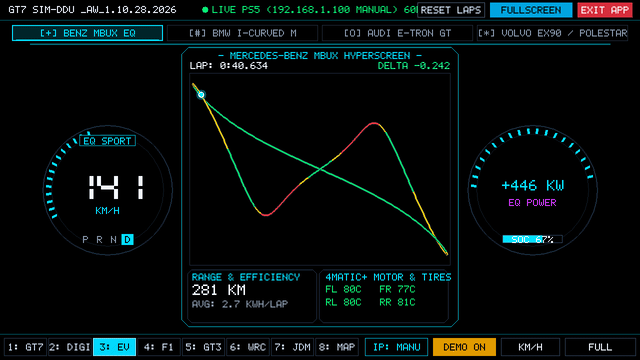

---

## 🏆 8 Motorsport- & Luxus-EV-Cockpit-Modi

### 1. Vier moderne Luxus-EV-Cockpits (`3: EV`)
| Mercedes-Benz MBUX Hyperscreen EQ | BMW i-Curved Display iDrive 9 M-EV |
| :---: | :---: |
| 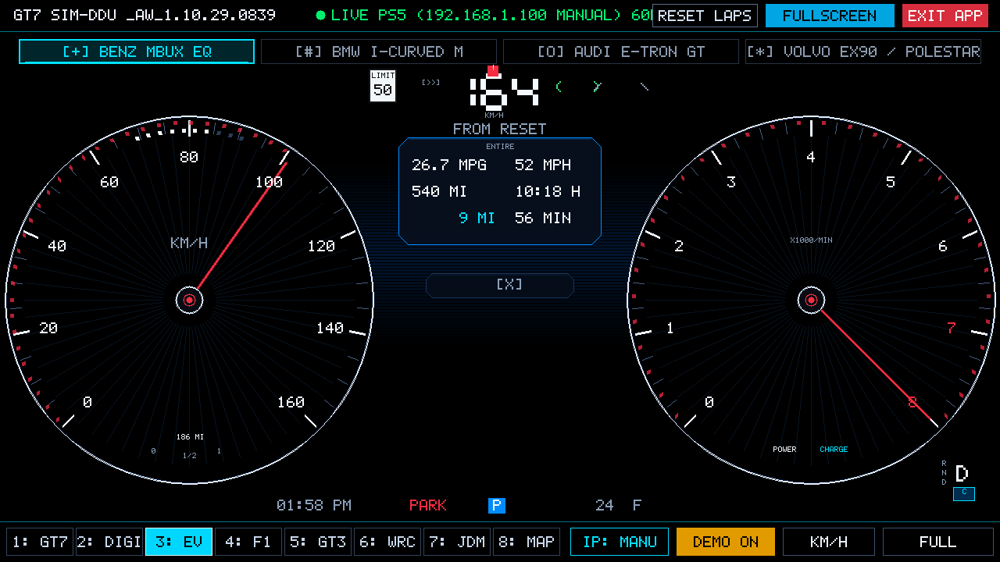 | 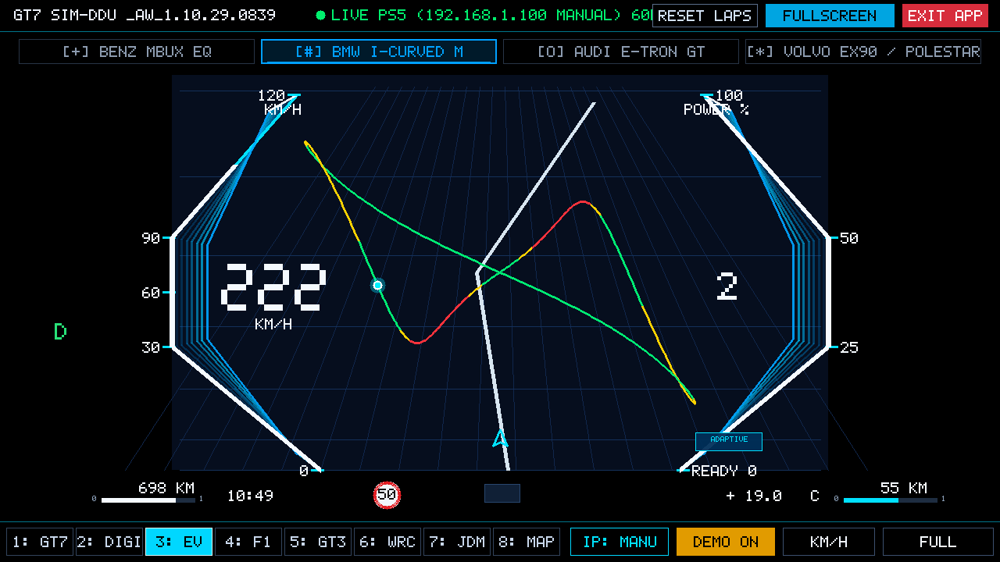 |
| **Audi Virtual Cockpit Plus e-tron GT** | **Volvo EX90 Skandinavischer Minimalismus** |
| 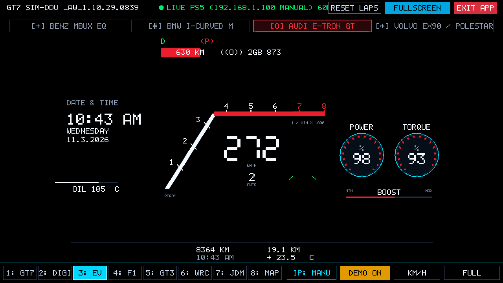 | 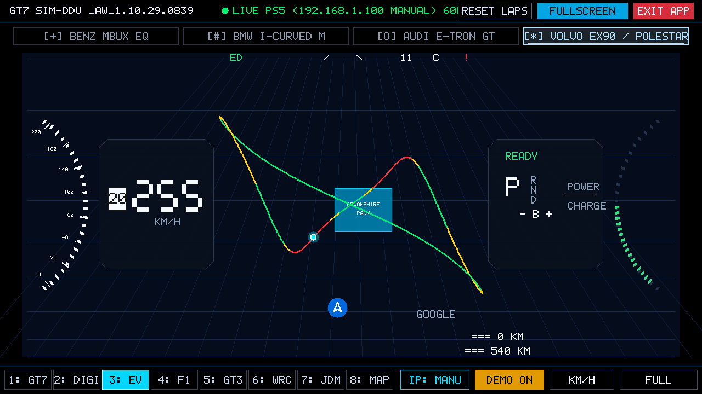 |

- **Mercedes-Benz MBUX Hyperscreen EQ**: Schwebende Doppelrundinstrumente mit cyanfarbenem Neonglühen, 0–100% Leistungsabgabe und Rekuperation, PRND-Fahrstufenanzeige und zentrales MBUX-Navigations-Track-Radar.
- **BMW i-Curved Display (iDrive 9 ///M Electric)**: Markante polygonale Geschwindigkeitsbögen, BMW M Electric Blue Akzente, dynamisches `>> eBOOST <<` Aufblitzen bei über 90% Gaspedalstellung, G-Kraft-Vektormeter.
- **Audi Virtual Cockpit Plus (e-tron GT RS)**: Klassisches Audi Sport Rundinstrumenten-Layout mit roten Skalenstrichen, 0–100% Boost- und Rekuperationsanzeige, dynamisches MMI Streckenradar.
- **Volvo EX90 / Polestar Minimalismus**: Skandinavisch elegantes, klares Design, hochkontrastige große Geschwindigkeitsanzeige im Zentrum und vertikales Bandmeter für linearen PWR / REGEN Energiefluss.

---

### 2. Offizielles GT7 HUD & Hochauflösender Digitaler Drehzahlmesser
| Mode 1: Offizielles GT7 HUD & MFD | Mode 2: High-Res Digitaler Drehzahlmesser |
| :---: | :---: |
| 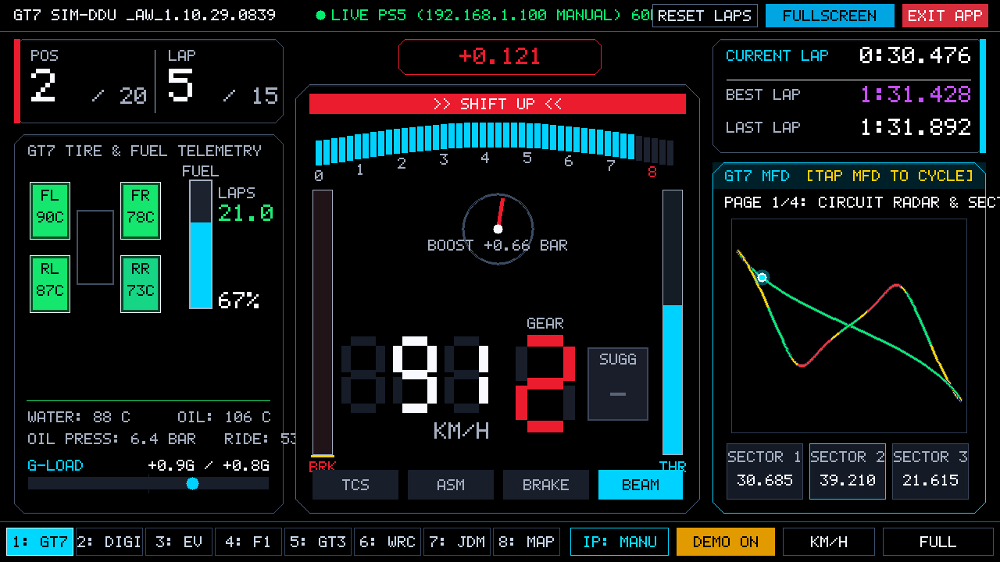 | 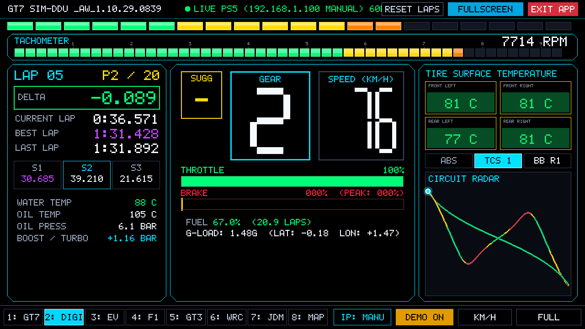 |

- **Mode 1: Offizielles GT7 HUD & MFD (`1: GT7`)**: Authentische Nachbildung des geschwungenen Polyphony Digital Horizont-Drehzahlmessers (46-Stufen-Farbverlauf), Schaltblitz-Warnanzeige, Ganganzeige mit Empfehlung und 4-seitiges umschaltbares MFD.
- **Mode 2: High-Res Digitaler Drehzahlmesser (`2: DIGI`)**: 32-stufiges LED-Schaltband, präzise numerische Drehzahlanzeige, Pedalwege für Gas/Bremse mit Spitzendruck-Speicher (Peak Brake), Reifentemperaturen und Delta-Zeit.

---

### 3. Professionelle Motorsport-Designs
| Mode 4: F1 Grand Prix Lenkrad-Display | Mode 5: GT3 Endurance MoTeC DDU |
| :---: | :---: |
| 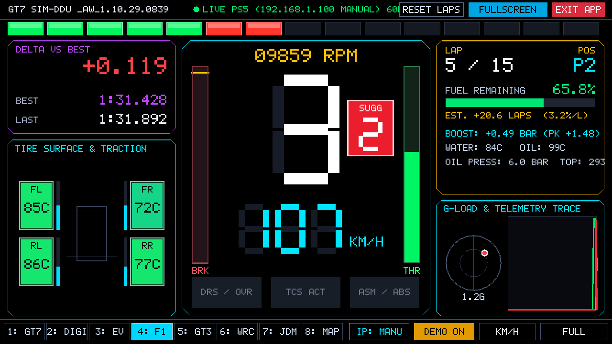 | 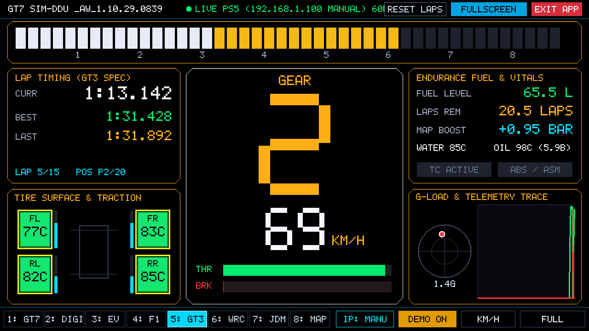 |
| **Mode 6: WRC Rallye Stage Cockpit** | **Mode 7: JDM Defi Advance ZD Zusatzanzeigen** |
| 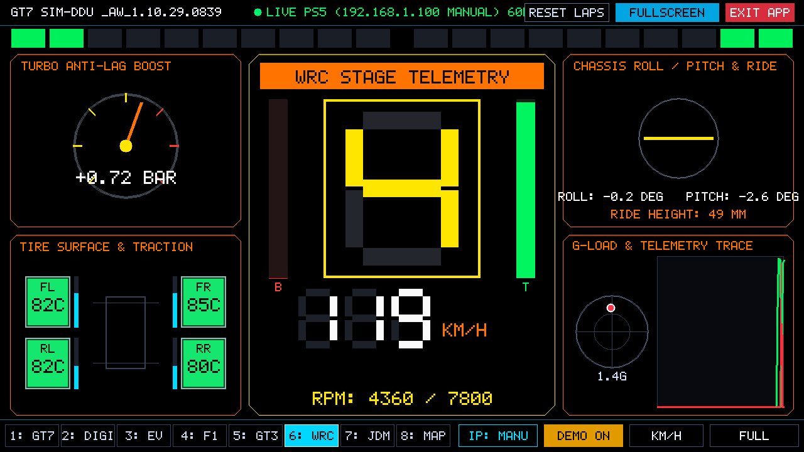 | 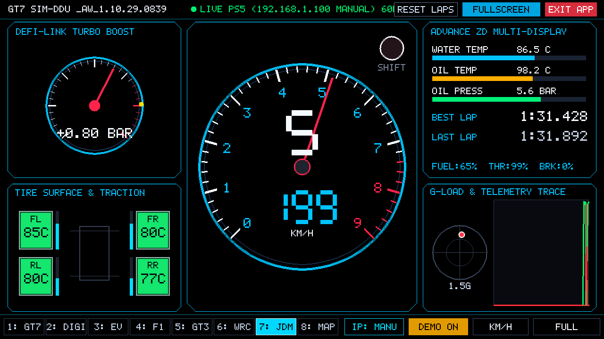 |

- **Mode 4: F1 Lenkrad (`4: F1`)**: Nachempfunden modernen F1 PCU-8D Lenkraddisplays (Mercedes W14 / Ferrari SF23).
- **Mode 5: GT3 MoTeC (`5: GT3`)**: MoTeC C1212 Langstrecken-DDU mit breitem Drehzahlband und Runden-Kraftstoffrechner.
- **Mode 6: WRC Rallye (`6: WRC`)**: Rallye-Cockpit mit integrierter Neigungs- und Rollanzeige (Künstlicher Horizont).
- **Mode 7: JDM Defi (`7: JDM`)**: Klassische japanische Tuning-Rundinstrumente für Ladedruck und Drehzahl kombiniert mit Advance ZD Multi-Anzeige.
- **Mode 8: GPS Streckenkarte (`8: MAP`)**: 2D GPS Rennstreckenlayout, Brems-/Gas-Heatmaps, Sektoren-Delta und Boxenstopp-Strategierechner.

---

## 👆 100% Joy-Con-freie Multi-Touch-Bedienung & Vollbild-Modus

| PS5 IP Touch-Ziffernblock | Vollbild Immersiver Canvas-Modus |
| :---: | :---: |
| 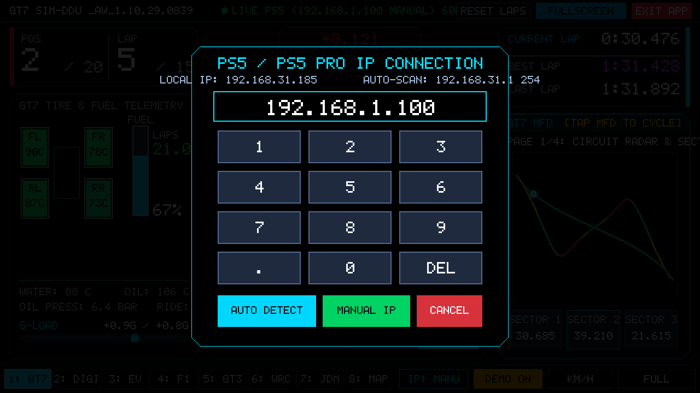 | 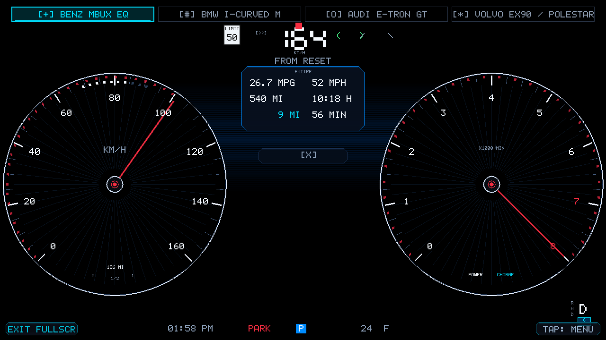 |

- **Randloses Vollbild (`FULL`)**: Die oberen und unteren Menüleisten lassen sich vollständig ausblenden – 100% Bildschirm-Ausnutzung auf dem 720p Switch-Display ohne Ränder. Ein Fingertipp unten links beendet den Vollbildmodus sofort.
- **Automatische Erkennung (`IP: AUTO`)**: Findet die PS5 / PS5 Pro beim Start automatisch via UDP-Broadcast. Auf Wunsch öffnet ein Fingertipp den Ziffernblock zur manuellen IP-Eingabe.
- **Pure OLED Schwarz Kalibrierung**: Alle inaktiven Displaybereiche sind auf reines `#000000` kalibriert für unendlichen Kontrast auf der Switch OLED.

---

## 🎮 Steuerung & Tastenbelegung

| Funktion | Switch Touchscreen (Ohne Joy-Cons) | Switch Hardware-Tasten | PC / Mac Simulator |
| :--- | :--- | :--- | :--- |
| **8 Modi umschalten** | Unten auf Dock tippen / Horizontal wischen | L / R, Steuerkreuz links / rechts | Tasten `1`–`8`, `L` / `R` |
| **EV Marke umschalten** | Oben auf Markentab tippen (Benz/BMW/Audi/Volvo) | Y-Taste (im EV-Modus) | Taste `E` |
| **Vollbild umschalten** | Oben rechts `FULLSCREEN` / unten `FULL` | Minus-Taste (`-`) | Taste `F` oder `F11` |
| **PS5 IP einstellen** | Unten auf `IP: AUTO` tippen | X-Taste | Taste `I` oder `X` |
| **Demo / Live PS5** | Unten auf `DEMO ON` tippen | Y-Taste (Nicht-EV-Modi) | Taste `D` oder `Y` |
| **Geschwindigkeitseinheit** | Unten auf `KM/H` / `MPH` tippen | A-Taste | Taste `U` oder `A` |
| **App beenden** | Oben rechts rotes `EXIT APP` tippen | Plus-Taste (`+`) | Taste `Q` oder `ESC` |
| **Strecke wechseln (Demo)** | Auf Streckenkarte tippen | — | Taste `C` |
| **Rundenzeiten zurücksetzen** | Oben auf `RESET LAPS` tippen | — | `Backspace`-Taste |

---

## 📦 Installation (Nintendo Switch Atmosphère)

1. Laden Sie die neueste `gt7_switch_hud.nro` von [GitHub Releases](https://github.com/d9053326-bot/gt7-switch-sim-ddu/releases) herunter.
2. Verbinden Sie Ihre microSD-Karte mit dem Computer und kopieren Sie `gt7_switch_hud.nro` in folgenden Pfad:
   ```
   /switch/gt7_hud/gt7_switch_hud.nro
   ```
   *(oder direkt in `/switch/gt7_switch_hud.nro`)*
3. Setzen Sie die microSD-Karte wieder in die Switch ein und starten Sie Atmosphère.
4. Öffnen Sie das Homebrew-Menü (Album) und starten Sie **GT7 Sim-DDU** mit einem Fingertipp!
5. Stellen Sie sicher, dass Switch und PS5 im selben WLAN sind. Sobald Sie in GT7 auf die Strecke fahren, startet die 60Hz Telemetrie automatisch!
