# GT7 & PC SimHub Switch Sim-DDU Pro (繁體中文)
**版本號: `_aw_1.11.05.2245` (PS5 GT7 + PC SimHub 雙遙測引擎 & True OLED Black 旗艦版)**

[English](README_EN.md) | [日本語](README_JA.md) | [Deutsch](README_DE.md)

專為 **Nintendo Switch (V1 / V2 / Switch OLED 大氣層 Atmosphère 破解系統)** 打造的原生 Homebrew 賽車儀表板 App (`.nro`)。透過 Wi-Fi 同時支援接收 **PS5 / PS5 Pro《Gran Turismo 7 (跑車浪漫旅 7)》** 與 **PC SimHub（Assetto Corsa、ACC、iRacing、F1、Forza、rFactor 2、EA WRC 等全平台賽車遊戲）** 60Hz UDP 遙測封包，將 Switch 拆下左右 Joy-Con 搖桿後，直接架設於賽車方向盤基座前方，化身為高精準度、低延遲的頂級 **Sim Racing DDU (Dashboard Display Unit)**。

---

## 🏎️ 即時動態遙測展示 (Live Telemetry Demo)

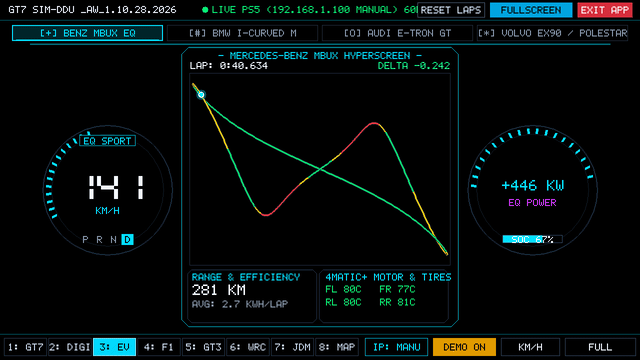

---

## 🏆 內建 8 大專業賽車與頂級電動車數位儀表板模式（共 11 種視圖）

### 1. 四大純電豪華品牌數位儀表板 (`3: EV`) 與 BMW iDrive 9 專屬四視圖
| Mercedes-Benz MBUX Hyperscreen EQ | BMW iDrive 9 `///M SPORT` 雙翼戰鬥儀表 |
| :---: | :---: |
| 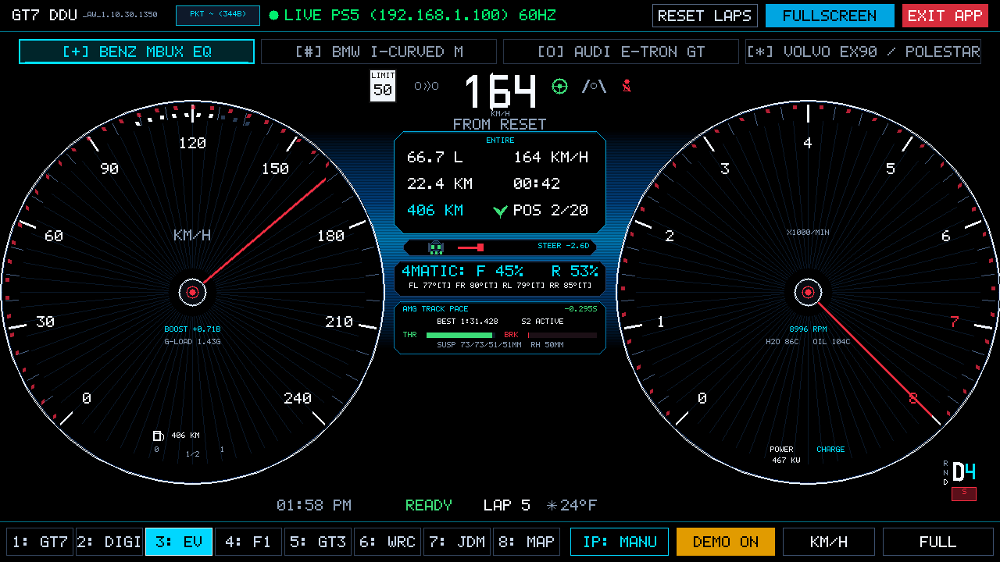 | 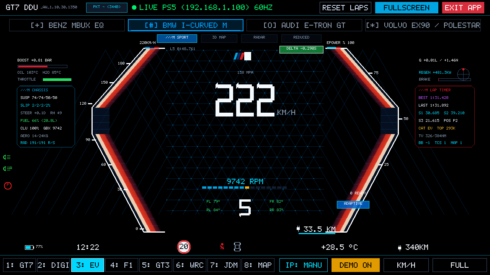 |
| **BMW iDrive 9 `3D MAP` 雙側幾何導航** | **BMW iDrive 9 `RADAR` 智慧輔助駕駛雷達** |
| 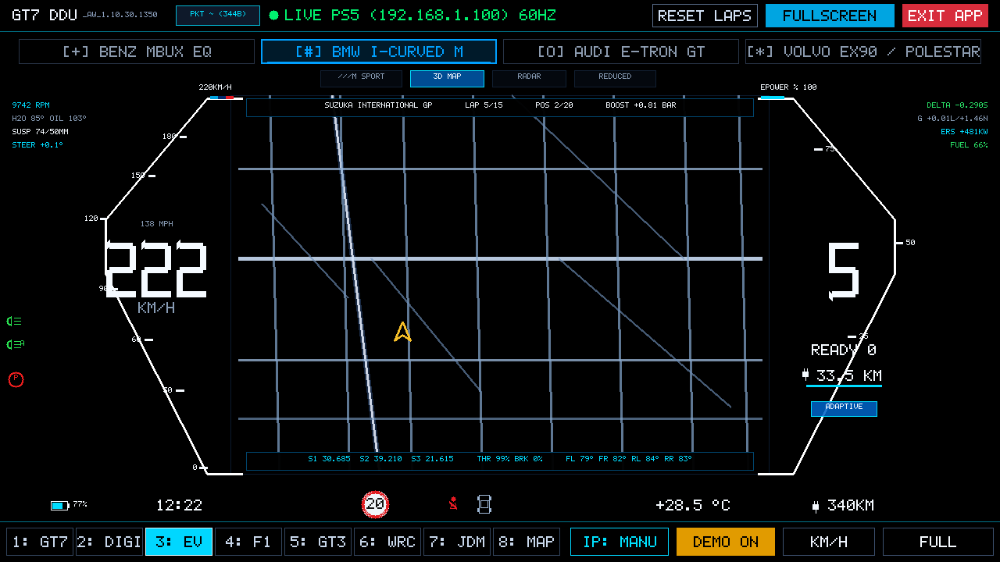 | 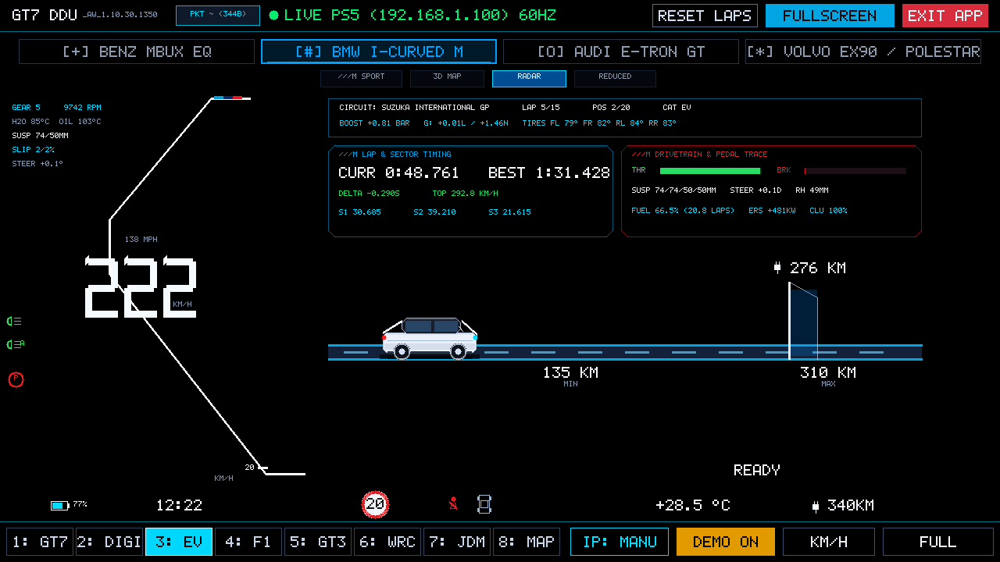 |
| **BMW iDrive 9 `REDUCED` 全景極簡地圖** | **Audi Virtual Cockpit Plus e-tron GT** |
| 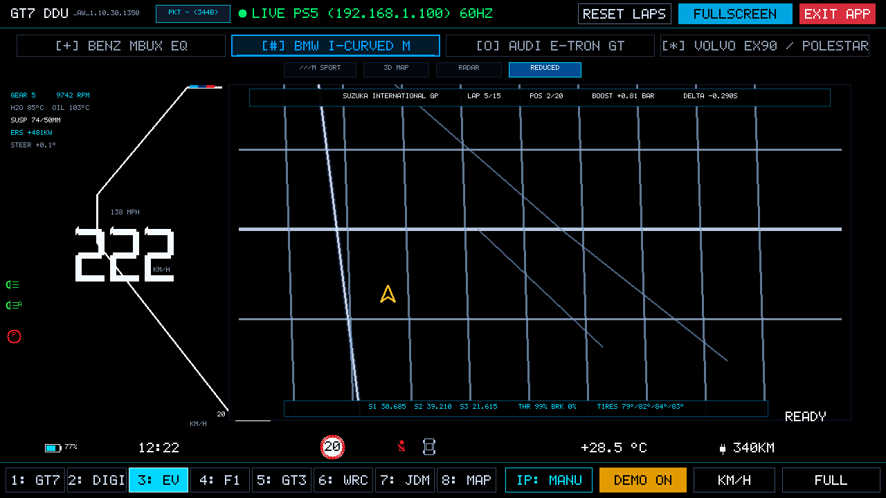 | 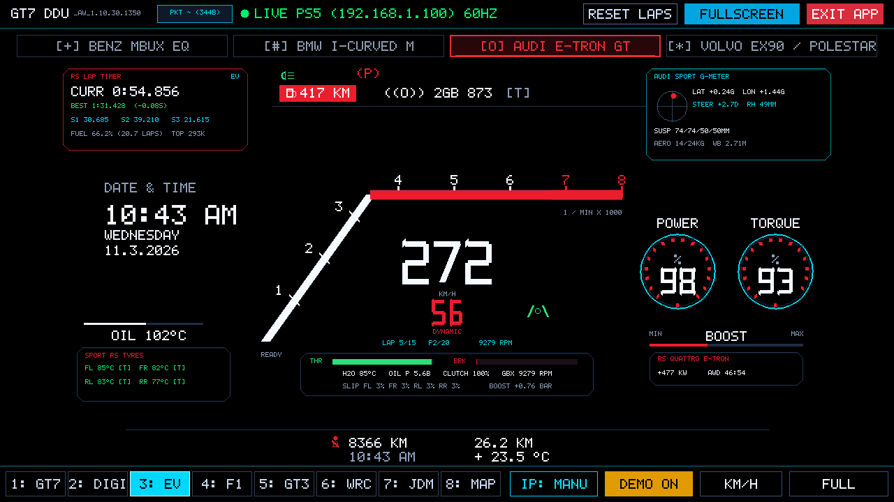 |
| **Volvo EX90 / Polestar Minimalist** | **全螢幕沉浸畫布模式 (`FULL`)** |
| 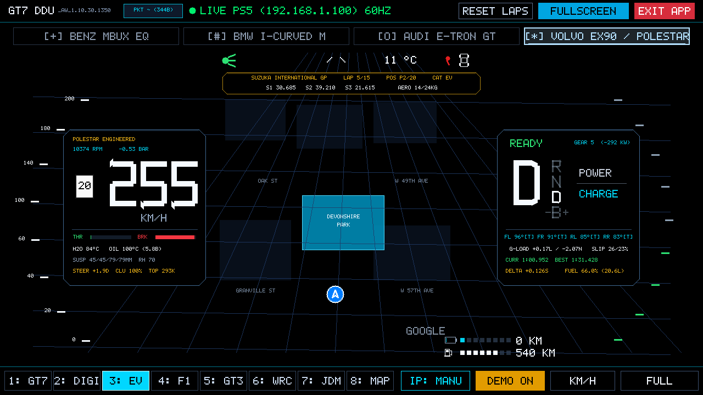 | 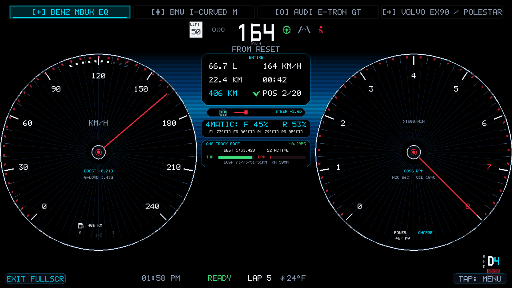 |

- **Mercedes-Benz MBUX Hyperscreen EQ**：雙圓懸浮放射星芒儀表、4MATIC 四驅扭力比例、四輪胎溫與接地材質 `[T/C/D]`、**AMG TRACK PACE** 單圈差時與避震行程監控。
- **BMW i-Curved Display (iDrive OS 8.5 / 9 四視圖套件)**：點擊上方子視圖標籤或按 `B` / `V` 鍵切換 **`///M SPORT`**、**`3D MAP`**、**`RADAR`**、**`REDUCED`** 四種原廠實車畫面，完整整合 `///M CHASSIS` 底盤避震/滑移率/下壓力與 `///M LAP TIMER` 單圈三區段計時。
- **Audi Virtual Cockpit Plus (RS e-tron GT)**：經典 Audi Sport 曲棍球桿轉速錶、雙環 Power/Torque、左上 **RS LAP TIMER** 與右上 **AUDI SPORT G-METER**。
- **Volvo EX90 / Polestar Minimalist**：北歐極簡斯堪地那維亞風格、左側 **Polestar Engineered** 動力底盤數據、頂部黃金賽道分段膠囊與中央 3D 導航地圖。

---

### 2. GT7 原廠官方 HUD 與高解析數位轉速儀表
| Mode 1: Official GT7 Native HUD & MFD | Mode 2: High-Res Digital Tachometer DDU |
| :---: | :---: |
| 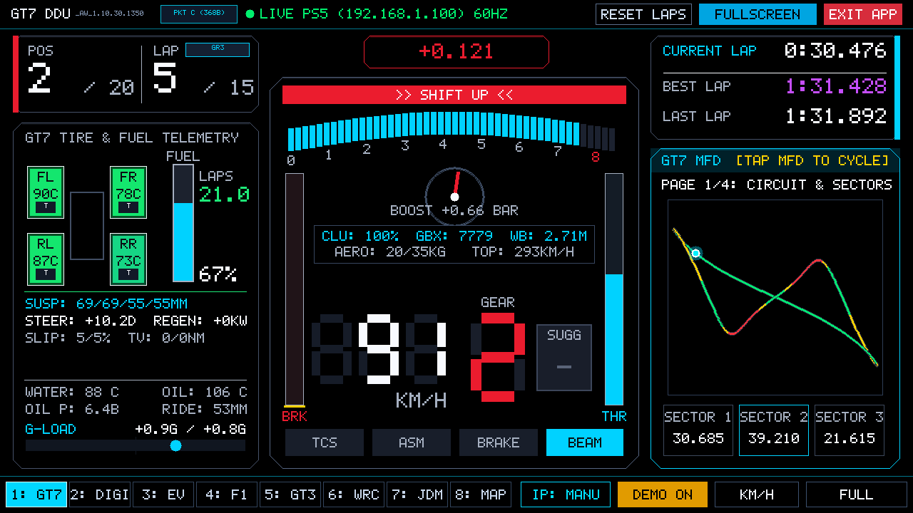 | 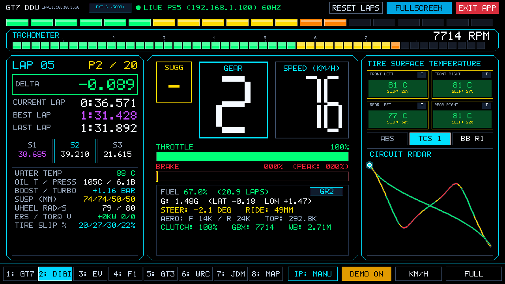 |

- **Mode 1: Official GT7 Native HUD & MFD (`1: GT7`)**：忠實還原 Polyphony Digital 原版 GT7 經典弧形地平線轉速光條、超轉紅區閃爍提示、車速/檔位/建議檔位，並整合 4 頁切換式 MFD。
- **Mode 2: High-Res Digital Tachometer DDU (`2: DIGI`)**：頂部 32 階漸變轉速燈條、油門與煞車雙條附帶踩踏峰值記憶（PEAK BRAKE）、獨立胎溫與 Delta 計時。

---

### 3. 專業賽事風格儀表
| Mode 4: F1 Grand Prix Steering Wheel | Mode 5: GT3 Endurance MoTeC DDU |
| :---: | :---: |
| 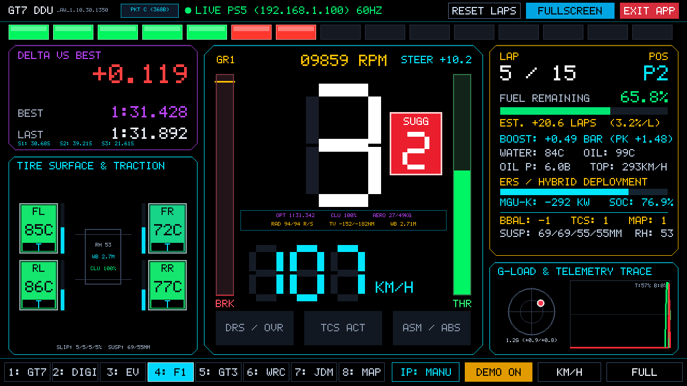 | 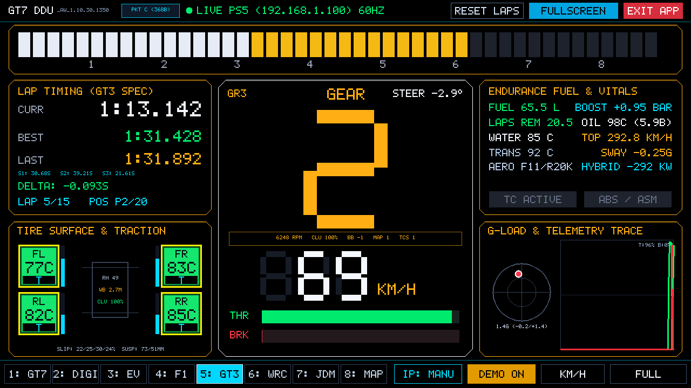 |
| **Mode 6: WRC Rally Stage Cockpit** | **Mode 7: JDM Defi Advance ZD Multi-Meter** |
| 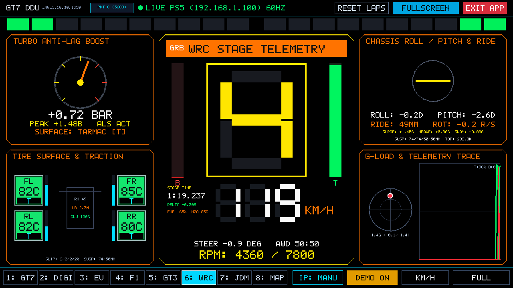 | 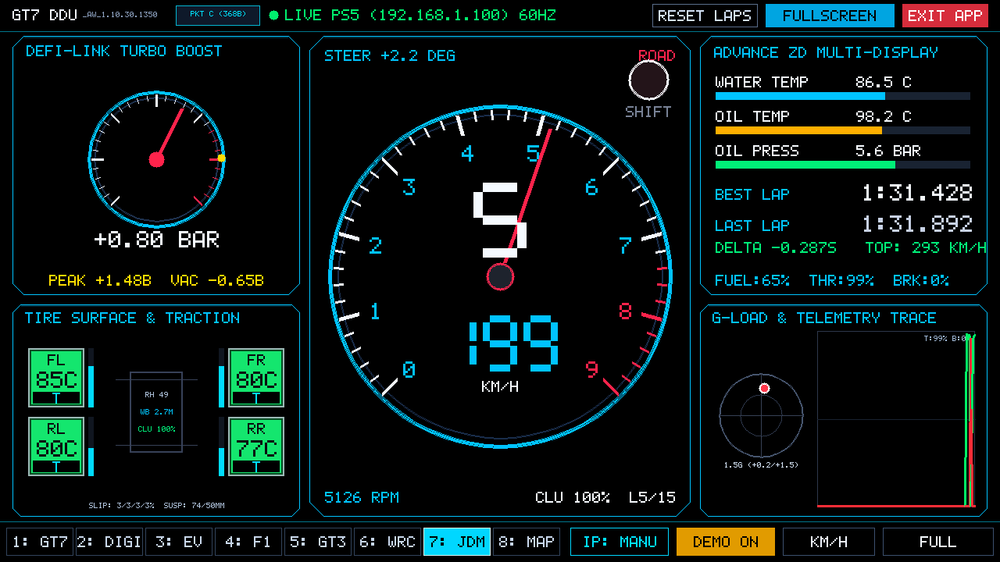 |

- **Mode 4: F1 Steering Wheel (`4: F1`)**：模擬 Mercedes W14 / Ferrari SF23 PCU-8D 方向盤儀表。
- **Mode 5: GT3 MoTeC (`5: GT3`)**：耐力賽標準 MoTeC C1212 寬幅掃描轉速錶、燃油圈數計算。
- **Mode 6: WRC Rally (`6: WRC`)**：拉力賽防滾籠專用 HUD，整合車身傾角儀（Roll / Pitch Horizon）。
- **Mode 7: JDM Defi (`7: JDM`)**：日系改裝經典指針式渦輪增壓錶與轉速大錶，搭配 Advance ZD 液晶條。
- **Mode 8: GPS Track Map (`8: MAP`)**：大尺寸 2D GPS 賽道圖、熱力著色行車線、最佳分段與進站窗口策略計算器。

---

## 👆 100% 零搖桿全觸控 & 全螢幕最大化設計

| PS5 IP 觸控數字鍵盤彈窗 | 全螢幕沉浸畫布模式 |
| :---: | :---: |
| 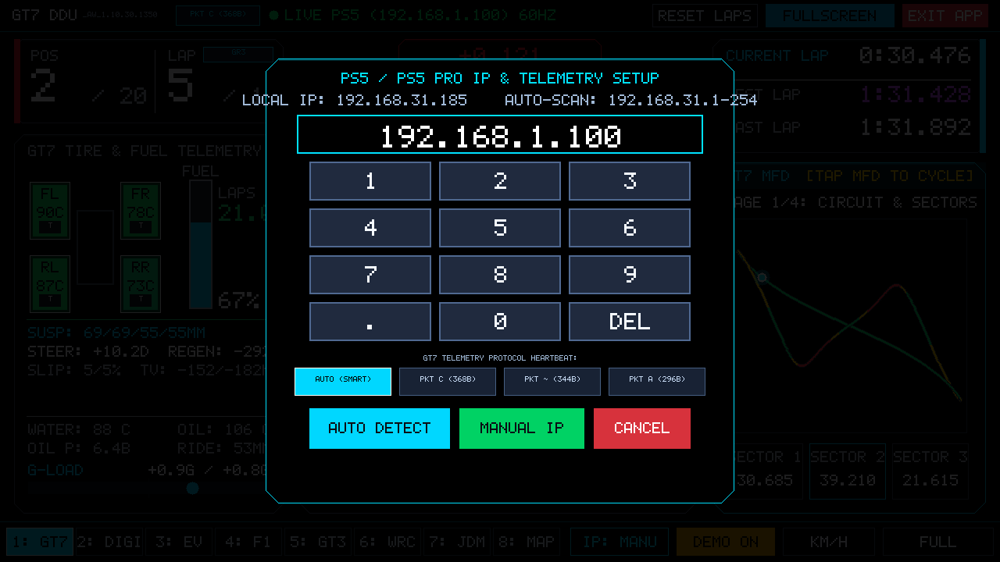 |  |

- **一鍵 100% 全螢幕 (`FULL`)**：頂部與底部導覽列自動收起，畫面 100% 滿版無黑邊；輕觸左下角即刻跳出全螢幕，輕觸右下角喚醒選單。
- **預設自動搜尋 (IP: AUTO)**：開機自動發送 UDP 廣播偵測 PS5 / PS5 Pro，無需手動輸入 IP；亦可點擊 IP 按鈕手動輸入。
- **純黑 OLED 校準**：非發光區域全數校準為 `#000000`，在 Switch OLED 螢幕上展現無限對比度。

---

## 🎮 控制與操作對照表

| 功能 | Switch 觸控螢幕 (無須 Joy-Con) | Switch 實體按鍵 | PC/Mac 模擬器鍵盤 |
| :--- | :--- | :--- | :--- |
| **切換 8 大模式** | 點擊底部 Dock 標籤 / 螢幕滑動 | L / R 鍵、十字鍵左右 | `1` ~ `8` 鍵、`L` / `R` 鍵 |
| **切換 EV 電車品牌** | 點擊頂部 4 大品牌標籤 (Benz/BMW/Audi/Volvo) | Y 鍵 (在 EV 模式下) | `E` 鍵 |
| **切換全螢幕** | 點擊右上角 `FULLSCREEN` / 底部 `FULL` | - 鍵 (Minus) | `F` 或 `F11` 鍵 |
| **PS5 IP 設定** | 點擊底部 `IP: AUTO` 彈出大鍵盤 | X 鍵 | `I` 或 `X` 鍵 |
| **切換 Demo/即時** | 點擊底部 `DEMO ON` | Y 鍵 (非 EV 模式) | `D` 或 `Y` 鍵 |
| **速度單位 (KM/H / MPH)** | 點擊底部 `KM/H` | A 鍵 | `U` 或 `A` 鍵 |
| **離開程式** | 點擊右上角紅色 `EXIT APP` 按鈕 | + 鍵 (Plus) | `Q` 或 `ESC` 鍵 |
| **切換賽道 (Demo)** | 點擊賽道地圖區域 | — | `C` 鍵 |
| **重置圈速計時** | 點擊頂部 `RESET LAPS` | — | `Backspace` 鍵 |

---

## 📦 安裝說明 (Switch 大氣層 Atmosphère)

1. 前往 GitHub Releases 下載最新版 `gt7_switch_hud.nro`。
2. 將 Switch 記憶卡插入電腦，將 `gt7_switch_hud.nro` 放入記憶卡路徑：
   ```
   /switch/gt7_hud/gt7_switch_hud.nro
   ```
   *(或直接放在 `/switch/gt7_switch_hud.nro`)*
3. 將記憶卡插回 Switch 並啟動大氣層系統。
4. 進入 Homebrew 相簿選單，點擊 **GT7 Sim-DDU** 圖標即可啟動！
5. **PS5《Gran Turismo 7》連線**：確保 Switch 與 PS5 連線至同一個 Wi-Fi 區域網路，進入 GT7 賽道後即可自動偵測並接收 60Hz 遙測！
6. **PC SimHub 連線（支援 5 種格式免改設定自動識別，完整映射 11 種儀表視圖）**：
   - **方式 A（SimHub 內建 UDP 轉發）**：在 PC SimHub 進入 `Settings` -> `Plugins` -> `UDP Forwarding`（或在遊戲遙測轉發中），將目標 IP 設為 Switch 的 IP（可點擊 Switch 畫面下方 `IP: AUTO` 查看 `SWITCH IP`），目標 Port 設為 **`20777`**（或 `33740`），格式可任選 **Codemasters (Mode 1, 264B)**、**Forza Data Out (232/311/324/331B)** 或 **OutGauge (92/96B)**。
   - **方式 B（Python 零依賴橋接腳本）**：在 PC 上直接執行內附工具：
     ```bash
     # 自動從 PC SimHub 讀取即時遙測並以 60Hz 推送至 Switch
     python3 tools/simhub_bridge.py --switch-ip <Switch的IP> --port 20777
     ```
   - **方式 C（SimHub Custom UDP JSON / 巢狀 Web API JSON）**：執行 `python3 tools/simhub_bridge.py --template` 複製 JSON 模板貼入 SimHub Custom UDP 輸出至 `<Switch的IP>:20777`（亦支援直接推送 `DataCorePlugin.GameData.*` 與巢狀 `NewData` JSON）。
